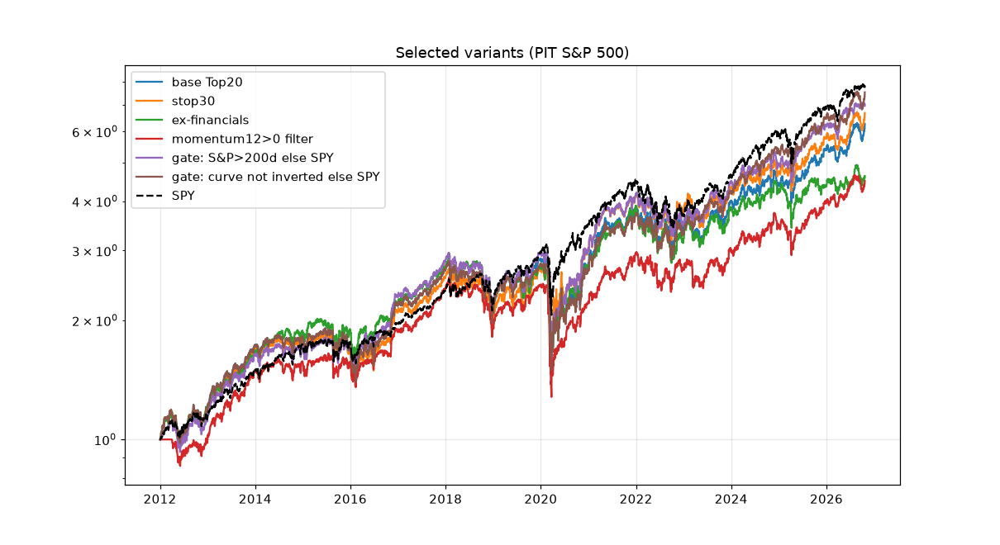

# hyp-robustness: parameter sensitivity and subperiods (point-in-time S&P 500, quarterly rebalance unless noted)

SPY CAGR: full period 14.8%, IS 12.3%, OOS 17.1%. By subperiod: 2012–15 14.8%, 2016–19 14.7%, 2020–22 7.3%, 2023–26 21.6%.

The vsBase and vsSPY columns are t-stats of the monthly return difference. The p-value is the larger of the t-test p and a 3-month block-bootstrap p. q_BH is computed within the variant table.

| variant              |   full_CAGR |   full_Sharpe |   full_MaxDD |   IS_CAGR |   OOS_CAGR |   full_vsSPY_t |   full_vsBase_t |   full_vsBase_p |   q_BH_vsBase |   OOS_vsBase_t |   CAGR_2012-15 |   CAGR_2016-19 |   CAGR_2020-22 |   CAGR_2023-26 |   turnover |
|:---------------------|------------:|--------------:|-------------:|----------:|-----------:|---------------:|----------------:|----------------:|--------------:|---------------:|---------------:|---------------:|---------------:|---------------:|-----------:|
| base Top20           |       0.132 |         0.683 |       -0.463 |     0.113 |      0.148 |         -0.233 |         nan     |         nan     |       nan     |        nan     |          0.146 |          0.137 |          0.062 |          0.171 |      1.52  |
| N=10                 |       0.106 |         0.552 |       -0.535 |     0.101 |      0.109 |         -0.669 |          -1.154 |           0.25  |         0.878 |         -1.076 |          0.153 |          0.112 |         -0.033 |          0.168 |      1.749 |
| N=15                 |       0.123 |         0.632 |       -0.516 |     0.103 |      0.14  |         -0.37  |          -0.62  |           0.539 |         0.878 |         -0.227 |          0.152 |          0.116 |          0.049 |          0.162 |      1.623 |
| N=25                 |       0.131 |         0.682 |       -0.484 |     0.123 |      0.136 |         -0.282 |          -0.236 |           0.829 |         0.931 |         -1.277 |          0.164 |          0.133 |          0.069 |          0.144 |      1.447 |
| N=30                 |       0.13  |         0.687 |       -0.483 |     0.125 |      0.134 |         -0.338 |          -0.284 |           0.779 |         0.912 |         -1.001 |          0.157 |          0.14  |          0.077 |          0.137 |      1.344 |
| N=40                 |       0.124 |         0.677 |       -0.463 |     0.118 |      0.128 |         -0.642 |          -0.732 |           0.465 |         0.878 |         -1.078 |          0.163 |          0.122 |          0.076 |          0.125 |      1.291 |
| N=50                 |       0.125 |         0.698 |       -0.434 |     0.114 |      0.135 |         -0.688 |          -0.596 |           0.558 |         0.878 |         -0.754 |          0.152 |          0.129 |          0.092 |          0.122 |      1.218 |
| stop25               |       0.137 |         0.768 |       -0.271 |     0.097 |      0.173 |         -0.17  |           0.179 |           0.864 |         0.932 |          0.788 |          0.14  |          0.107 |          0.147 |          0.158 |      1.528 |
| stop30               |       0.137 |         0.752 |       -0.304 |     0.104 |      0.167 |         -0.124 |           0.473 |           0.702 |         0.88  |          1.014 |          0.139 |          0.127 |          0.115 |          0.164 |      1.513 |
| stop40               |       0.134 |         0.722 |       -0.372 |     0.112 |      0.153 |         -0.158 |           0.506 |           0.621 |         0.878 |          0.606 |          0.146 |          0.136 |          0.08  |          0.165 |      1.506 |
| stop50               |       0.128 |         0.681 |       -0.437 |     0.113 |      0.141 |         -0.286 |          -0.43  |           0.668 |         0.88  |         -0.429 |          0.146 |          0.137 |          0.056 |          0.161 |      1.51  |
| monthly rebal        |       0.136 |         0.701 |       -0.487 |     0.127 |      0.143 |         -0.114 |           0.524 |           0.601 |         0.878 |         -0.382 |          0.156 |          0.148 |          0.053 |          0.175 |      2.25  |
| semiannual rebal     |       0.14  |         0.725 |       -0.463 |     0.115 |      0.162 |         -0.006 |           0.652 |           0.515 |         0.878 |          0.76  |          0.153 |          0.134 |          0.111 |          0.158 |      1.142 |
| annual rebal         |       0.097 |         0.546 |       -0.5   |     0.099 |      0.094 |         -1.34  |          -1.956 |           0.052 |         0.711 |         -1.97  |          0.159 |          0.079 |          0.066 |          0.081 |      0.844 |
| mcap>2B              |       0.133 |         0.687 |       -0.463 |     0.113 |      0.15  |         -0.204 |           1.152 |           0.269 |         0.878 |          1.153 |          0.146 |          0.137 |          0.062 |          0.174 |      1.517 |
| mcap>10B             |       0.136 |         0.724 |       -0.461 |     0.115 |      0.154 |         -0.091 |           0.557 |           0.578 |         0.878 |          0.466 |          0.145 |          0.141 |          0.077 |          0.171 |      1.422 |
| P/FCF 8/12           |       0.131 |         0.675 |       -0.49  |     0.115 |      0.146 |         -0.225 |           0.018 |           0.987 |         0.987 |         -0.049 |          0.154 |          0.135 |          0.054 |          0.171 |      1.469 |
| P/FCF 12/20          |       0.126 |         0.658 |       -0.492 |     0.12  |      0.131 |         -0.426 |          -0.799 |           0.425 |         0.878 |         -1.378 |          0.166 |          0.129 |          0.059 |          0.137 |      1.526 |
| P/E<=12              |       0.135 |         0.691 |       -0.458 |     0.121 |      0.146 |         -0.136 |           0.584 |           0.577 |         0.878 |         -0.173 |          0.159 |          0.136 |          0.075 |          0.158 |      1.496 |
| P/E<=18              |       0.137 |         0.708 |       -0.458 |     0.117 |      0.154 |         -0.102 |           0.884 |           0.403 |         0.878 |          0.718 |          0.153 |          0.137 |          0.084 |          0.165 |      1.51  |
| P/B<1                |       0.137 |         0.703 |       -0.469 |     0.121 |      0.151 |         -0.066 |           0.79  |           0.43  |         0.878 |          0.25  |          0.166 |          0.129 |          0.067 |          0.173 |      1.485 |
| P/B<2                |       0.127 |         0.662 |       -0.487 |     0.111 |      0.14  |         -0.348 |          -0.723 |           0.486 |         0.878 |         -0.868 |          0.145 |          0.131 |          0.057 |          0.164 |      1.529 |
| ROE>10%              |       0.136 |         0.691 |       -0.48  |     0.116 |      0.153 |         -0.098 |           0.675 |           0.5   |         0.878 |          0.522 |          0.149 |          0.141 |          0.083 |          0.161 |      1.492 |
| ROE>20%              |       0.123 |         0.639 |       -0.497 |     0.121 |      0.123 |         -0.469 |          -1.427 |           0.184 |         0.878 |         -2.626 |          0.16  |          0.132 |          0.038 |          0.145 |      1.457 |
| no rising-NI rule    |       0.139 |         0.696 |       -0.494 |     0.111 |      0.164 |          0.02  |           0.853 |           0.395 |         0.878 |          1.115 |          0.164 |          0.115 |          0.062 |          0.203 |      1.483 |
| D/E<0.5              |       0.146 |         0.736 |       -0.463 |     0.121 |      0.168 |          0.17  |           1.491 |           0.138 |         0.878 |          1.595 |          0.144 |          0.161 |          0.098 |          0.172 |      1.468 |
| D/E<2                |       0.129 |         0.664 |       -0.509 |     0.113 |      0.141 |         -0.291 |          -0.297 |           0.771 |         0.912 |         -0.365 |          0.164 |          0.116 |          0.077 |          0.148 |      1.533 |
| score>=6 only        |       0.08  |         0.519 |       -0.463 |     0.05  |      0.107 |         -2.231 |          -2.908 |           0.004 |         0.084 |         -2.158 |          0.123 |          0.045 |          0.004 |          0.136 |      1.045 |
| cost 30bps           |       0.125 |         0.655 |       -0.463 |     0.107 |      0.141 |         -0.43  |          -7.453 |           0     |         0.01  |         -5.398 |          0.14  |          0.131 |          0.056 |          0.164 |      1.523 |
| ex Materials+Staples |       0.14  |         0.715 |       -0.468 |     0.119 |      0.158 |          0.005 |           1.454 |           0.148 |         0.878 |          1.154 |          0.159 |          0.136 |          0.066 |          0.187 |      1.476 |

