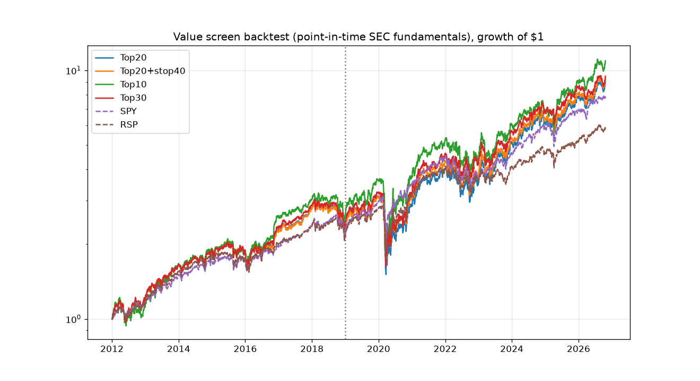

# value-screen-backtest

A rules-based, point-in-time backtest of a value checklist taken from the *Investing Club* YouTube channel (2019–2022): Buffett, Phil Town (Rule #1), Peter Lynch's PEG and Greenblatt-style metrics.

**Research only, not investment advice.**

## Strategy (parameters fixed in advance from the creator's stated rules; nothing was tuned)
- **Rebalance:** quarterly, on the first trading day of Jan, Apr, Jul and Oct (2012-01 to 2026-10).
- **Must pass (all companies):** market cap > $500M, net income > 0 and above the prior year (rising earnings).
- **Must pass (non-financials only):** FCF (CFO − capex) > 0, long-term debt / equity < 1, and current ratio > 1 when it is reported.
- **Score:**
  - P/FCF < 10 (2 points) or < 15 (1 point)
  - P/E ≤ 15
  - PEG < 1, using 3-year net income CAGR
  - P/B < 1.5
  - ROE > 15%
  - revenue growth > 5%
  - net income growth > 15%
- **Ranking:** by score, with ties broken by earnings yield. Buy the top N at equal weight, capped at 5% (Top 10 is uncapped at 10% each, because a 5% cap would leave it half in cash).
- **Optional stop:** sell a position if it falls 40% from its peak since entry. The cash is held until the next rebalance.
- **Costs:** 10 bps on traded notional.

## Data, point in time
- **Fundamentals:** SEC EDGAR XBRL `companyfacts`. Each value is used only after its **first filing date**, so restatements cause no lookahead. Flow items (net income, revenue, CFO, capex) are annual 10-K figures. Balance-sheet items and shares are the latest 10-K or 10-Q values.
- **Market cap:** yfinance close with splits backed out, multiplied by the shares outstanding reported on the cover page.
- **Prices:** yfinance adjusted close. Benchmarks are SPY (cap-weighted) and RSP (equal-weight S&P 500).

## Results (2012-01-03 to 2026-10-22)
The 2019–2026 period is effectively out of sample, since the rules came from videos made in 2019–2022 and were not fitted to data. Turnover is one-way per year over the full period.

| strategy     | period         | CAGR   | Vol   |   Sharpe | MaxDD   | turnover   |
|:-------------|:---------------|:-------|:------|---------:|:--------|:-----------|
| Top20        | Full 2012-2026 | 16.0%  | 22.7% |     0.77 | -51.8%  | 170%       |
| Top20        | 2012-2018      | 12.6%  | 16.0% |     0.82 | -27.9%  | 170%       |
| Top20        | 2019-2026      | 19.1%  | 27.4% |     0.78 | -51.8%  | 170%       |
| Top20+stop40 | Full 2012-2026 | 16.3%  | 21.1% |     0.82 | -43.0%  | 175%       |
| Top20+stop40 | 2012-2018      | 12.5%  | 16.0% |     0.82 | -27.9%  | 175%       |
| Top20+stop40 | 2019-2026      | 19.7%  | 24.9% |     0.85 | -43.0%  | 175%       |
| Top10        | Full 2012-2026 | 17.5%  | 24.6% |     0.78 | -52.9%  | 186%       |
| Top10        | 2012-2018      | 14.6%  | 17.3% |     0.88 | -24.7%  | 186%       |
| Top10        | 2019-2026      | 20.1%  | 29.6% |     0.77 | -52.9%  | 186%       |
| Top10+stop40 | Full 2012-2026 | 17.5%  | 22.8% |     0.82 | -46.4%  | 191%       |
| Top10+stop40 | 2012-2018      | 14.6%  | 17.3% |     0.88 | -24.7%  | 191%       |
| Top10+stop40 | 2019-2026      | 20.0%  | 26.8% |     0.82 | -46.4%  | 191%       |
| Top30        | Full 2012-2026 | 16.4%  | 22.3% |     0.8  | -49.8%  | 157%       |
| Top30        | 2012-2018      | 13.3%  | 15.7% |     0.87 | -26.5%  | 157%       |
| Top30        | 2019-2026      | 19.2%  | 26.8% |     0.79 | -49.8%  | 157%       |
| Top30+stop40 | Full 2012-2026 | 16.7%  | 20.8% |     0.85 | -40.4%  | 161%       |
| Top30+stop40 | 2012-2018      | 13.2%  | 15.7% |     0.87 | -26.5%  | 161%       |
| Top30+stop40 | 2019-2026      | 19.8%  | 24.4% |     0.86 | -40.4%  | 161%       |
| SPY          | Full 2012-2026 | 14.8%  | 16.5% |     0.92 | -33.7%  |            |
| SPY          | 2012-2018      | 12.3%  | 12.8% |     0.97 | -19.3%  |            |
| SPY          | 2019-2026      | 17.1%  | 19.2% |     0.92 | -33.7%  |            |
| RSP          | Full 2012-2026 | 12.8%  | 16.9% |     0.8  | -39.0%  |            |
| RSP          | 2012-2018      | 11.7%  | 13.2% |     0.91 | -19.8%  |            |
| RSP          | 2019-2026      | 13.7%  | 19.7% |     0.75 | -39.0%  |            |



### Calendar-year returns (2026 is year to date)
|   Date | Top20   | Top20+stop40   | Top10   | Top10+stop40   | Top30   | Top30+stop40   | SPY    | RSP    |
|-------:|:--------|:---------------|:--------|:---------------|:--------|:---------------|:-------|:-------|
|   2012 | 21.2%   | 21.2%          | 14.3%   | 14.3%          | 20.7%   | 20.7%          | 14.2%  | 15.4%  |
|   2013 | 37.5%   | 37.5%          | 46.3%   | 46.3%          | 37.9%   | 37.9%          | 32.3%  | 35.5%  |
|   2014 | 14.7%   | 14.7%          | 14.1%   | 14.1%          | 13.4%   | 13.4%          | 13.5%  | 14.1%  |
|   2015 | -3.4%   | -3.4%          | -2.4%   | -2.4%          | -1.5%   | -1.5%          | 1.2%   | -2.7%  |
|   2016 | 21.6%   | 20.7%          | 37.1%   | 37.1%          | 24.3%   | 23.8%          | 12.0%  | 14.5%  |
|   2017 | 23.9%   | 23.9%          | 17.9%   | 17.9%          | 23.4%   | 23.4%          | 21.7%  | 18.5%  |
|   2018 | -17.7%  | -17.7%         | -13.8%  | -13.8%         | -16.2%  | -16.3%         | -4.6%  | -7.8%  |
|   2019 | 35.3%   | 35.3%          | 39.2%   | 39.2%          | 34.6%   | 34.6%          | 31.2%  | 28.9%  |
|   2020 | -6.1%   | 1.1%           | 4.5%    | 9.9%           | 0.6%    | 8.0%           | 18.3%  | 12.7%  |
|   2021 | 38.6%   | 38.6%          | 39.3%   | 39.3%          | 42.7%   | 42.7%          | 28.7%  | 29.4%  |
|   2022 | -12.7%  | -12.8%         | -15.9%  | -15.9%         | -8.6%   | -8.6%          | -18.2% | -11.6% |
|   2023 | 45.5%   | 41.7%          | 36.6%   | 29.2%          | 34.4%   | 32.0%          | 26.2%  | 13.7%  |
|   2024 | 20.7%   | 20.4%          | 13.8%   | 13.4%          | 20.4%   | 19.1%          | 24.9%  | 12.8%  |
|   2025 | 25.0%   | 24.3%          | 29.3%   | 29.5%          | 23.5%   | 23.1%          | 17.7%  | 11.2%  |
|   2026 | 17.1%   | 17.1%          | 23.3%   | 23.3%          | 12.3%   | 12.3%          | 12.9%  | 15.3%  |

## Current portfolio (Top 20 as of 2026-10-22)
See [`current_portfolio.csv`](current_portfolio.csv): RNR, ALL, VNO, ACGL, HIG, FAF, SIGI, PGR, THG, TRV, CRUS, L, PYPL, EG, ORI, PRU, LDOS, WTFC, G, RGA.

## Caveats
- **Survivorship bias:** the universe is *today's* S&P 500 + S&P 400, so companies that went bankrupt or were acquired between 2012 and 2026 are missing. This almost certainly inflates returns. A survivorship-free version needs historical index membership plus prices for delisted names.
- **Missing data:** about 100–270 names per date lack usable XBRL data or price history (early years especially), and OZK has no SEC XBRL data at all (it files with the FDIC).
- **Sector labels:** financials are identified with *current* yfinance sectors, and a few names have no label.
- **Stale and coarse fundamentals:** annual flow data can be up to about 15 months old. The XBRL tag choice is simple (LongTermDebt only, so leases and short-term debt are ignored).
- **Concentration:** the screen heavily favors insurers, banks and other financials, so results are a concentrated factor bet (value plus financials) with higher volatility and drawdown than SPY.
- **Cost model:** no taxes, no slippage beyond 10 bps, and the risk-free rate is 0 in the Sharpe ratio.

## Run
```
pip install -r requirements.txt
python fetch_sec.py      # SEC companyfacts (sets a User-Agent)
python fetch_prices.py   # yfinance prices (re-run for tickers Yahoo rate-limits)
python backtest.py
python make_readme.py
```
