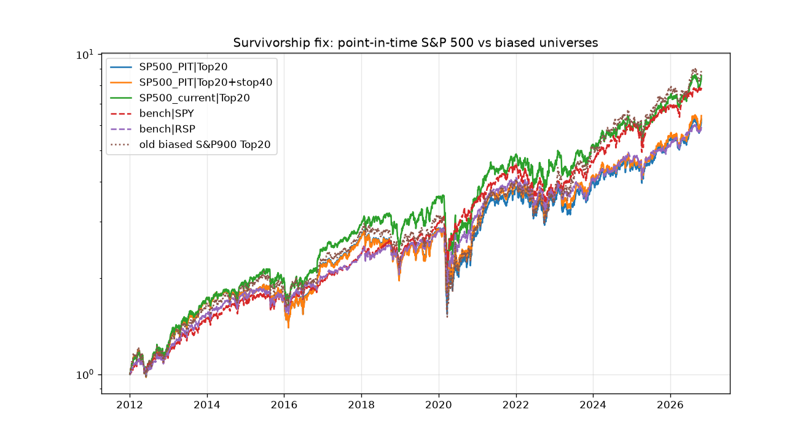

# Survivorship-bias fix

## What changed
- **Universe:** point-in-time **S&P 500** membership from [fja05680/sp500](https://github.com/fja05680/sp500) (`sp500_ticker_start_end.csv`). Removal reasons come from Wikipedia's S&P 500 change table (revision 1355685534).
- **Ticker renames:** 26 old tickers are mapped to their current ticker (for example FB→META, UTX→RTX, ANTM→ELV).
- **Removed and delisted names:**
  - There are 248 such names (not renames) whose S&P 500 membership overlapped 2012–2026.
  - **213** were matched to an SEC CIK (via the current ticker map or an exact name match against `cik-lookup-data.txt`). Eleven matches pointed to a different company that now uses the old ticker, so they were dropped.
  - **Prices:** yfinance only. Stooq now serves a JavaScript bot challenge and was **not** used.
  - **Coverage of delisted names:** only **60 of 248 (24%)** have usable prices over their membership window, and 59 have both prices and SEC fundamentals. For acquired companies coverage is **5 of 112 (4%)**.
  - When a held stock's price series ends (acquired or delisted), the position is exited at the last available close, which approximates the cash deal price for cash takeovers. None of the priced removed names was labelled a bankruptcy, so a −100% rule never triggered.
- **Usable share of S&P 500 members by date** (has SEC XBRL data and prices):
| date       |   members |   usable |      pct |
|:-----------|----------:|---------:|---------:|
| 2012-02-01 |       497 |      356 | 0.716298 |
| 2013-02-01 |       497 |      368 | 0.740443 |
| 2014-02-03 |       497 |      374 | 0.752515 |
| 2015-02-02 |       499 |      381 | 0.763527 |
| 2016-02-01 |       507 |      402 | 0.792899 |
| 2017-02-01 |       506 |      418 | 0.826087 |
| 2018-02-01 |       506 |      430 | 0.849802 |
| 2019-02-01 |       505 |      439 | 0.869307 |
| 2020-02-03 |       505 |      450 | 0.891089 |
| 2021-02-01 |       505 |      460 | 0.910891 |
| 2022-02-01 |       505 |      466 | 0.922772 |
| 2023-02-01 |       503 |      476 | 0.946322 |
| 2024-02-01 |       504 |      482 | 0.956349 |
| 2025-02-03 |       503 |      487 | 0.968191 |
| 2026-02-02 |       503 |      494 | 0.982107 |
- **Financials and sectors:** the financial flag and sectors now come from **SEC SIC codes** (`data/sic.csv`) instead of current yfinance sectors.
- **S&P 400:** no free point-in-time S&P 400 membership was found, so the corrected universe is the **S&P 500 only**. `SP500_current` (today's S&P 500 members run over all history) is included as an apples-to-apples biased comparison.

## Corrected baseline vs. biased runs
| universe                         | strategy     | period    | CAGR   | Vol   |   Sharpe | MaxDD   | turnover   |
|:---------------------------------|:-------------|:----------|:-------|:------|---------:|:--------|:-----------|
| bench                            | RSP          | 2012-2018 | 11.7%  | 13.2% |     0.91 | -19.8%  |            |
| bench                            | RSP          | 2019-2026 | 13.7%  | 19.7% |     0.75 | -39.0%  |            |
| bench                            | RSP          | Full      | 12.8%  | 16.9% |     0.8  | -39.0%  |            |
| bench                            | SPY          | 2012-2018 | 12.3%  | 12.8% |     0.97 | -19.3%  |            |
| bench                            | SPY          | 2019-2026 | 17.1%  | 19.2% |     0.92 | -33.7%  |            |
| bench                            | SPY          | Full      | 14.8%  | 16.5% |     0.92 | -33.7%  |            |
| S&P500+400 current (old, biased) | Top10        | 2012-2018 | 14.6%  | 17.3% |     0.88 | -24.7%  | 186%       |
| S&P500+400 current (old, biased) | Top10        | 2019-2026 | 20.1%  | 29.6% |     0.77 | -52.9%  | 186%       |
| S&P500+400 current (old, biased) | Top10        | Full      | 17.5%  | 24.6% |     0.78 | -52.9%  | 186%       |
| SP500_PIT                        | Top10        | 2012-2018 | 10.1%  | 17.6% |     0.64 | -32.8%  | 175%       |
| SP500_PIT                        | Top10        | 2019-2026 | 10.9%  | 27.1% |     0.52 | -53.3%  | 175%       |
| SP500_PIT                        | Top10        | Full      | 10.6%  | 23.1% |     0.55 | -53.5%  | 175%       |
| SP500_current                    | Top10        | 2012-2018 | 13.6%  | 16.4% |     0.86 | -28.8%  | 176%       |
| SP500_current                    | Top10        | 2019-2026 | 16.5%  | 27.0% |     0.7  | -53.7%  | 176%       |
| SP500_current                    | Top10        | Full      | 15.2%  | 22.6% |     0.74 | -53.7%  | 176%       |
| S&P500+400 current (old, biased) | Top20        | 2012-2018 | 12.6%  | 16.0% |     0.82 | -27.9%  | 170%       |
| S&P500+400 current (old, biased) | Top20        | 2019-2026 | 19.1%  | 27.4% |     0.78 | -51.8%  | 170%       |
| S&P500+400 current (old, biased) | Top20        | Full      | 16.0%  | 22.7% |     0.77 | -51.8%  | 170%       |
| SP500_PIT                        | Top20        | 2012-2018 | 11.3%  | 16.9% |     0.72 | -30.0%  | 152%       |
| SP500_PIT                        | Top20        | 2019-2026 | 14.8%  | 25.2% |     0.68 | -46.3%  | 152%       |
| SP500_PIT                        | Top20        | Full      | 13.2%  | 21.7% |     0.68 | -46.3%  | 152%       |
| SP500_current                    | Top20        | 2012-2018 | 14.6%  | 15.9% |     0.94 | -24.2%  | 149%       |
| SP500_current                    | Top20        | 2019-2026 | 16.4%  | 25.1% |     0.73 | -46.1%  | 149%       |
| SP500_current                    | Top20        | Full      | 15.6%  | 21.2% |     0.79 | -46.1%  | 149%       |
| S&P500+400 current (old, biased) | Top20+stop40 | 2012-2018 | 12.5%  | 16.0% |     0.82 | -27.9%  | 175%       |
| S&P500+400 current (old, biased) | Top20+stop40 | 2019-2026 | 19.7%  | 24.9% |     0.85 | -43.0%  | 175%       |
| S&P500+400 current (old, biased) | Top20+stop40 | Full      | 16.3%  | 21.1% |     0.82 | -43.0%  | 175%       |
| SP500_PIT                        | Top20+stop40 | 2012-2018 | 11.2%  | 16.9% |     0.71 | -30.0%  | 151%       |
| SP500_PIT                        | Top20+stop40 | 2019-2026 | 15.3%  | 23.0% |     0.74 | -37.2%  | 151%       |
| SP500_PIT                        | Top20+stop40 | Full      | 13.4%  | 20.3% |     0.72 | -37.2%  | 151%       |
| SP500_current                    | Top20+stop40 | 2012-2018 | 14.5%  | 15.8% |     0.94 | -24.2%  | 147%       |
| SP500_current                    | Top20+stop40 | 2019-2026 | 16.7%  | 22.9% |     0.79 | -37.7%  | 147%       |
| SP500_current                    | Top20+stop40 | Full      | 15.7%  | 19.9% |     0.84 | -37.7%  | 147%       |
| S&P500+400 current (old, biased) | Top30        | 2012-2018 | 13.3%  | 15.7% |     0.87 | -26.5%  | 157%       |
| S&P500+400 current (old, biased) | Top30        | 2019-2026 | 19.2%  | 26.8% |     0.79 | -49.8%  | 157%       |
| S&P500+400 current (old, biased) | Top30        | Full      | 16.4%  | 22.3% |     0.8  | -49.8%  | 157%       |
| SP500_PIT                        | Top30        | 2012-2018 | 12.5%  | 16.2% |     0.81 | -30.5%  | 134%       |
| SP500_PIT                        | Top30        | 2019-2026 | 13.4%  | 24.7% |     0.63 | -47.6%  | 134%       |
| SP500_PIT                        | Top30        | Full      | 13.0%  | 21.1% |     0.69 | -48.3%  | 134%       |
| SP500_current                    | Top30        | 2012-2018 | 15.2%  | 15.4% |     1    | -24.7%  | 134%       |
| SP500_current                    | Top30        | 2019-2026 | 17.0%  | 24.7% |     0.76 | -48.0%  | 134%       |
| SP500_current                    | Top30        | Full      | 16.2%  | 20.8% |     0.83 | -48.0%  | 134%       |

## Takeaways
- **The edge was mostly survivorship.** Top 20 falls from **16.0% CAGR** (biased S&P 900) and **15.6%** (biased S&P 500) to **13.2%** on the point-in-time S&P 500, below SPY's **14.8%**, with a lower Sharpe (0.68 vs 0.92) and a deeper max drawdown (−46% vs −34%). It still beats equal-weight RSP (12.8%).
- **Residual bias remains in both directions:**
  - About 28% of 2012 members are not usable, mostly later-acquired companies. Missing takeover premiums likely biases the corrected result **down**.
  - Missing failures biases it **up**.
  - The net direction is unknown.
